<!-- _class: statement cover -->

AI時代のOS Omarchy

@komagata

---

<!-- _class: content self-intro -->

## 自己紹介

 @komagata

 フィヨルドブートキャンプ

---


---

<!-- _class: content -->

## 今日の目的

- みなさんにOmarchyを知ってもらう
- そしてOmarchyに乗り換えてもらう

---

<!-- _class: statement -->

## というかみなさん

---

<!-- _class: statement -->

## １会社の社員だけが

---

<!-- _class: statement -->

## クローズドで

---

<!-- _class: statement -->

## 昔ながらの手作りで作ったOS

---

<!-- _class: statement -->

## 使ってていいんですか？

---

<!-- _class: statement -->

## １会社の社員だけが
## クローズドで
## 昔ながらの手作りで作ったOS
## 使ってていいんですか？

---

<!-- _class: statement -->

## 世界中の

---

<!-- _class: statement -->

## 楽観主義者たちが

---

<!-- _class: statement -->

## AI全振りで作ったOS

---

<!-- _class: statement -->

## 世界中の
## 楽観主義者たちが
## AI全振りで作ったOS
## 使わなくていいんですか？

---

<!-- _class: statement -->

## つかわないでいると・・・

---


---


<!-- _class: content -->

## Omarchyとは

Beatiful, Fun, Agentic Linux by DHH

DHHの作った美しく、楽しい、エージェンティックなLinux

---


<!-- _class: content dhh-profile -->

## DHHとは

**David Heinemeier Hansson**


- **Ruby on Railsの作者**（2003年に開発）
- **37signalsの共同オーナー・CTO**。Basecamp、HEYを開発
- **Omarchyの作者**。LinuxをAI時代のOSへ
- **Rails Foundation会長／Omacom Foundation代表**
- **Shopifyの取締役**（2024年〜）
- Jason Friedとの共著：**REWORK、REMOTE、Getting Real、
  It Doesn't Have to Be Crazy at Work**
- **レーシングドライバー**。2014年ル・マン24時間でクラス優勝
- デンマークのスタートアップへの投資家

<!--
プロフィール出典: https://dhh.dk/ （2026-10-30確認）
CTO表記: https://world.hey.com/dhh/it-s-a-beelink-baby-243fdaf1 の本人プロフィール
-->

---

<!-- _class: statement -->

Omarchy = Omakase + Arch Linux

---

<!-- _class: content -->

## Arch Linuxとは

最小限のシステムから全て自分で選んで作り上げていくカスタマイズ性の高さが特徴のLinux。

中級者以上向けとして有名。

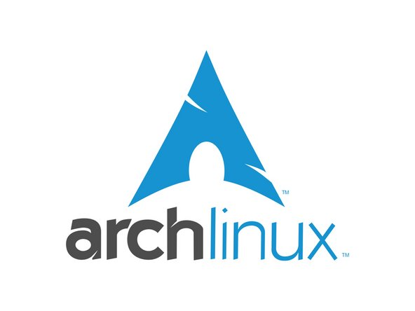

---

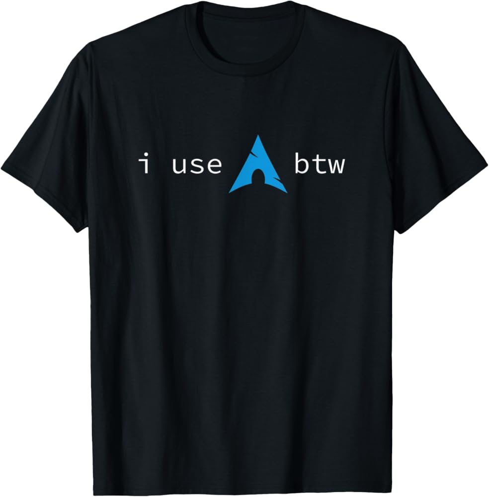

---

<!-- _class: content -->

## "ちなみにArchを使っています"とは

聞かれてもいないのに、会話の途中で突然
『ちなみにArch使ってるんだよね』
と言い出すというミーム

---


---

<!-- _class: statement -->

OmarchyはそんなArchがベースになってる
（カスタマイズのベースとして優秀）

---

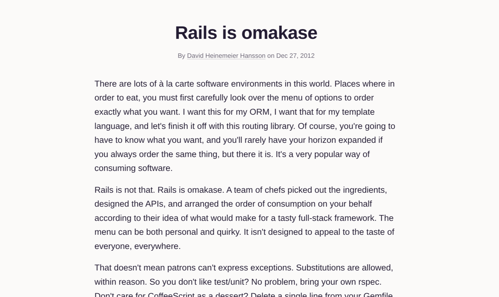

---

<!-- _class: statement compact -->

DHHという頑固な寿司屋の大将が決めた
Webアプリ設計のおすすめメニュー

---

<!-- _class: statement -->

我々はだまって口に運べば幸せ
（自分で選ぶより大抵は）

---

<!-- _class: statement -->

Omarchy is Omakase too

---

<!-- _class: statement -->

Railsで有名になった寿司屋の大将が出したおすすめOS

---

<!-- _class: statement -->

我々はだまって口に運べば幸せ
（自分で選ぶより大抵は）

---

<!-- _class: statement -->

Beatiful, Fun, Agentic Linux **by DHH**

---

<!-- _class: statement -->

いや、俺のほうが目利きだ！
という方はArchを使うべき

---

<!-- _class: statement -->

## 機能的な特徴

---

<!-- _class: statement -->

## タイル型ウィンドウマネージャー

---

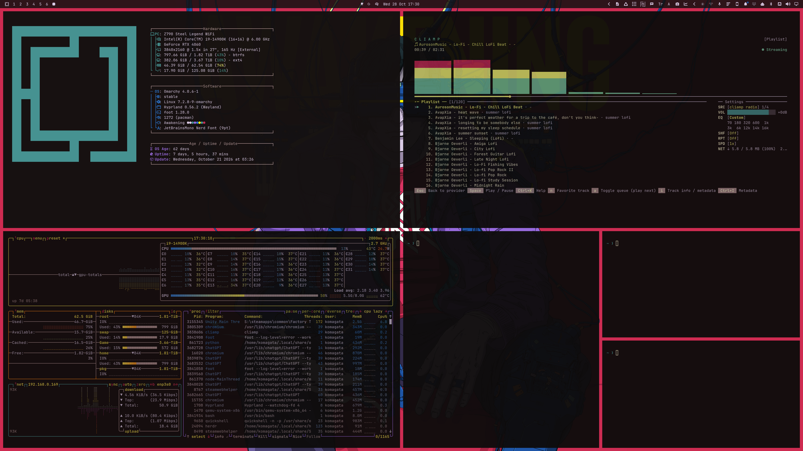

---

<!-- _class: statement -->

全部キーボードで操作

---

<!-- _class: statement -->

あの！

---

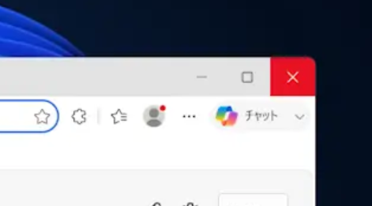

---

<!-- _class: statement -->

あの！醜い！

---

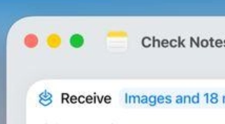

---

<!-- _class: statement -->

あの！醜い！３つのボタンが無い！

---

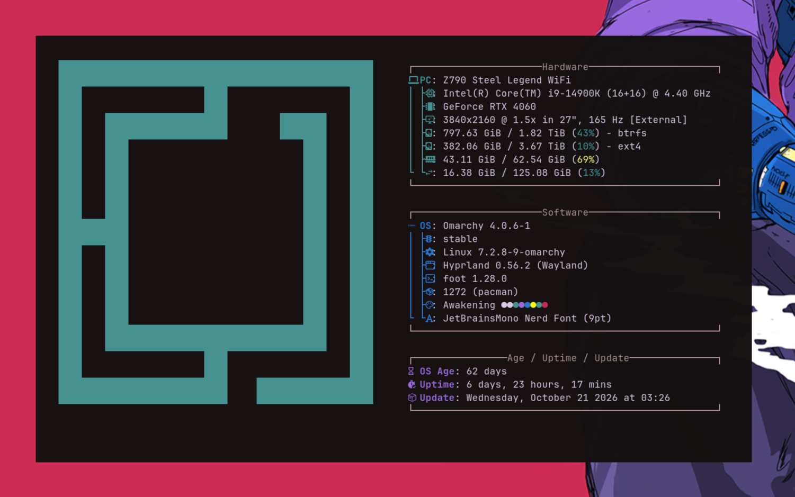

---

<!-- _class: statement -->

**Beatiful**, Fun, Agentic Linux by DHH

---

<!-- _class: statement -->

## テーマとの完全な統合

---

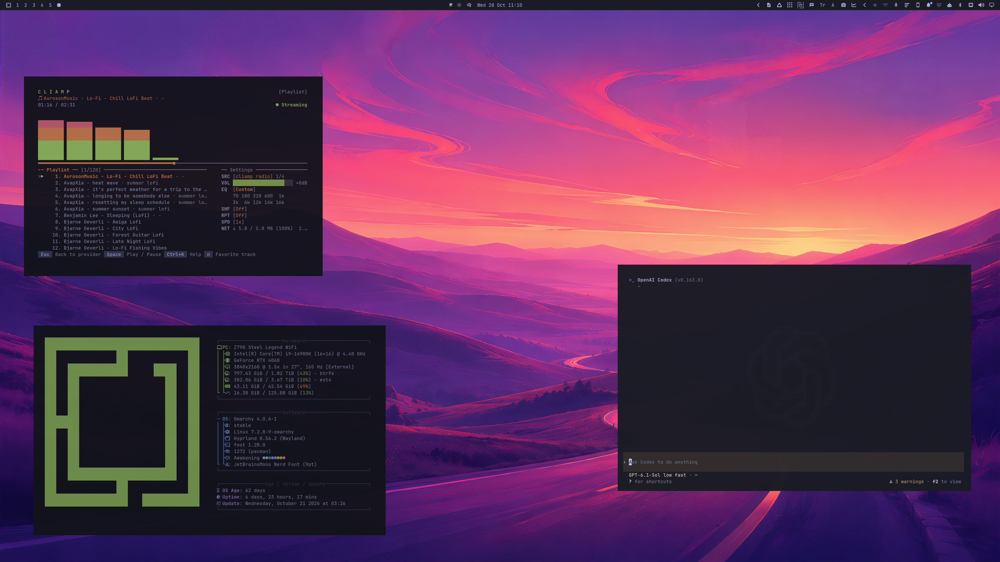

---

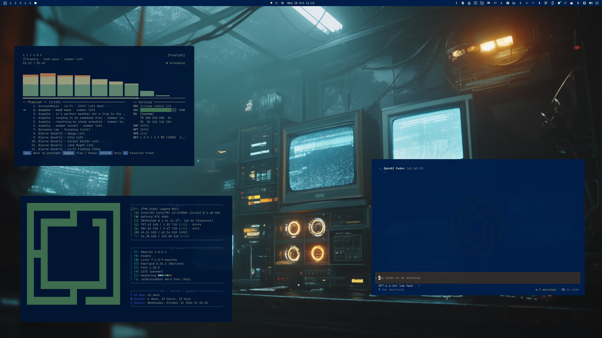

---

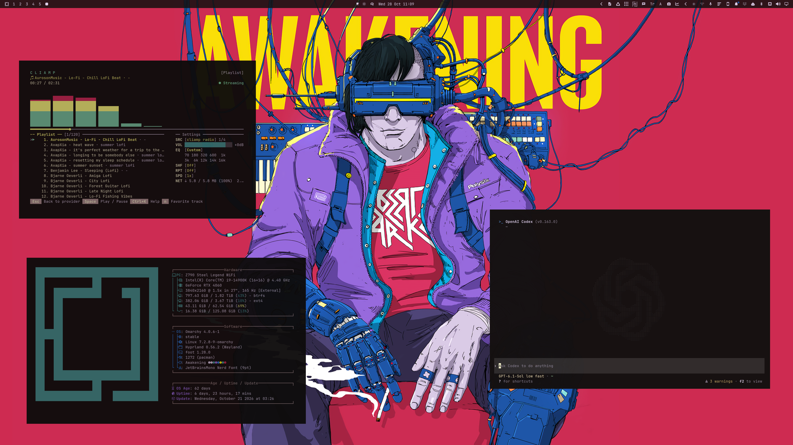

---

<!-- _class: content -->

## テーマとの完全な統合

ライトモード、ダークモードとかの非じゃない

あらゆる場所の文字色・背景色がテーマと結びついてる。

---

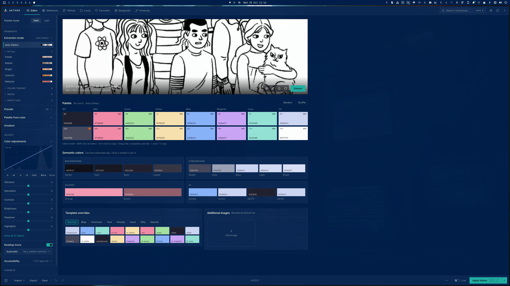

---

<!-- _class: content theme-command -->

## インストール+切り替えはコマンド一つ

```
$ omarchy theme install https://github.com/komagata/omarchy-kawasaki-refinery-theme
```

---

<!-- _class: statement -->

**Beatiful**, Fun, Agentic Linux by DHH

---

<!-- _class: statement -->

## AI Agentがデフォルト

---

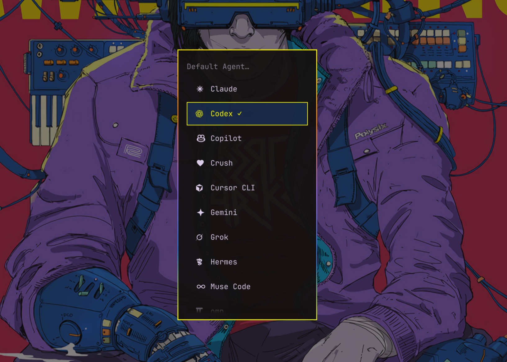

---

<!-- _class: content agent-help -->

## omarchy agent --help

```
$ omarchy agent --help
Usage:
  omarchy agent [--inline] [--pick]

Launch the default coding agent in a terminal

Arguments:
  [--inline] [--pick]

Examples:
  omarchy agent
  omarchy agent --inline

Binary:
  omarchy-agentRelated commands:
  omarchy agent crash <pid> [comm] [exe] [signal]                                     Diagnose a crashed process with the default coding agent
  omarchy agent prompt [--inline] <prompt...>                                         Launch the default coding agent with a prompt
  omarchy agent usage update [--force] [--limits-only] [--except <agent>] [agent...]  Regenerate the AI agent usage data files
```

---

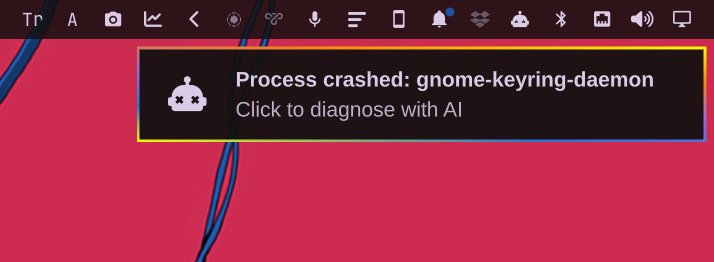

---

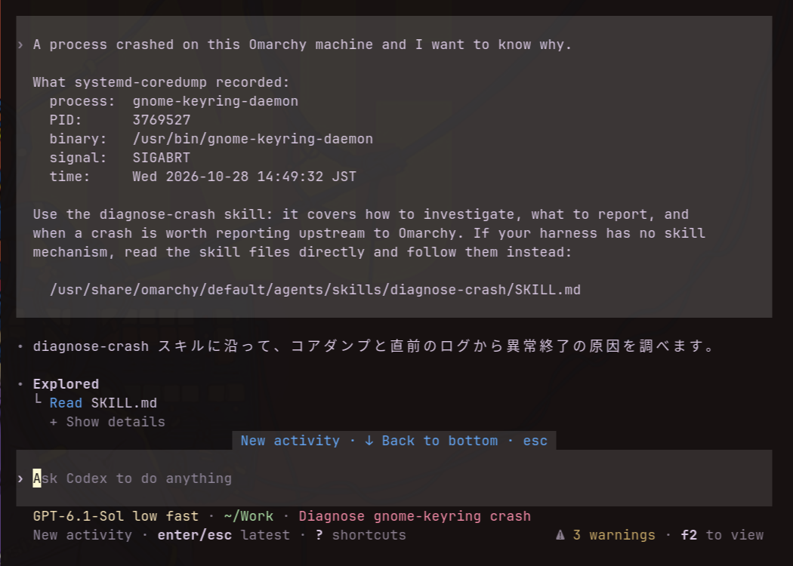

---

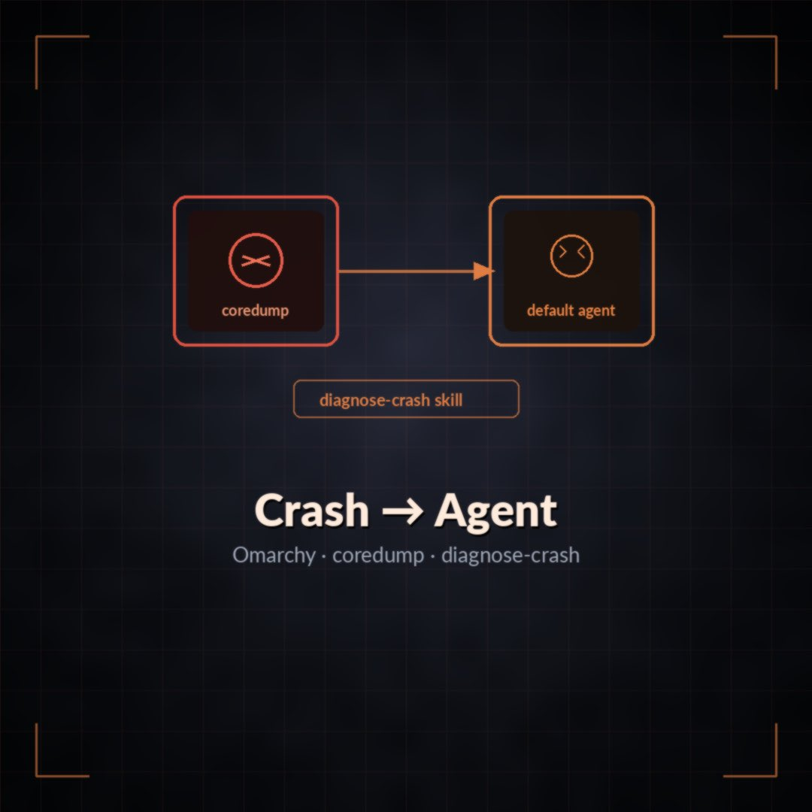

---

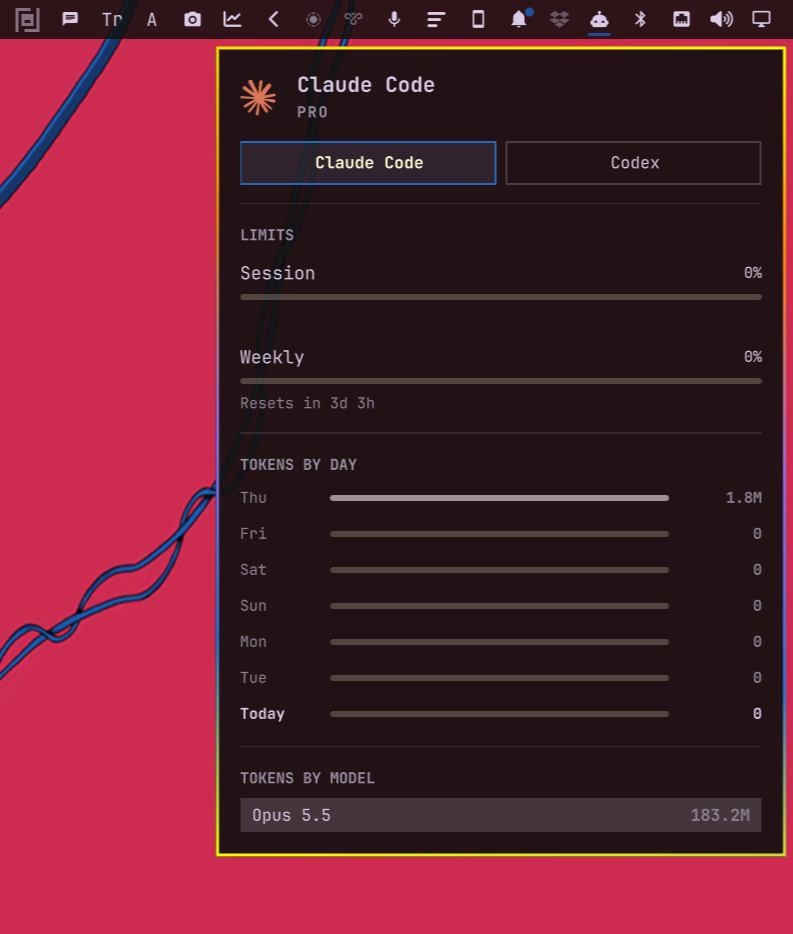

---

<!-- _class: content -->

## AIによる設定

ファイルベースの設定のおかげで今やLinuxはWindowsやMacよりはるかに正確に素早くAIが設定してくれるOS

---

<!-- _class: statement -->

Beatiful, Fun, **Agentic Linux** by DHH

---

<!-- _class: statement -->

## 音声入力がデフォルト

---

<!-- _class: content -->

## 音声入力

F9を押しながら話す。F9を話したら送られる。


---


<!-- _class: statement -->

## 軽い・速い

---

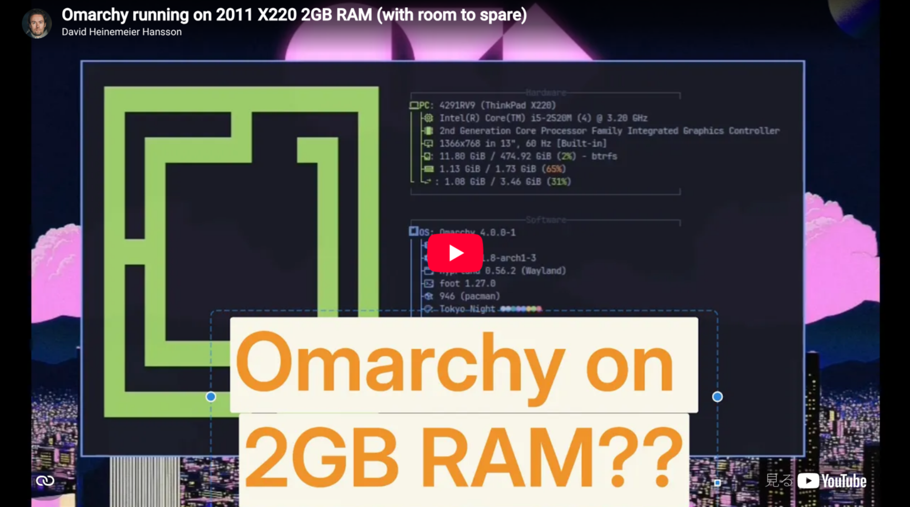

---

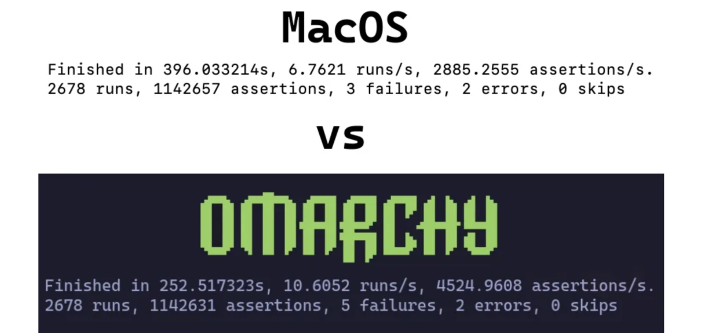

---

<!-- _class: content -->

## 軽い・速い

DHHの2011年の2GBメモリのThinkpadでも問題なし

2019年製MacBook Proで、Omarchyの導入により36%の性能改善

個人的にもmacOs TahoeとOmarchyをIntel Macで体感比較

F1インストーラー 12秒

---

<!-- _class: statement -->

## ゲーム

---

<!-- _class: content gaming -->

## Steamのゲームも、Linuxで

Windows向けゲームを動かす **Proton** がSteamに統合。

Valve公式も「大半のゲームがそのまま動く」と説明。

- Steam Deckでも使われている互換技術
- タイトルごとの動作状況はProtonDBで確認
- アンチチートなどの制約で遊べないゲームもある

※僕のやりたいゲームは全部動く

<!--
確認日: 2026-10-30
Valve公式の一般的なProton互換性の説明。Omarchy固有の実測や対応率ではない。
出典: https://partner.steamgames.com/doc/steamhardware/proton?l=english
動作報告: https://www.protondb.com/
-->

---

<!-- _class: content gaming -->

## VALORANT・Fortnite・Apexは？

対戦ゲームでは、アンチチートのLinux対応が分かれ目。

| ゲーム | Omarchyで直接プレイ | 現在の状況 |
| --- | --- | --- |
| VALORANT | × | PC版はWindowsが必要 |
| Fortnite | ×（対応準備中） | EpicがLinux対応に向けて開発中 |
| Apex Legends | × | 運営がLinuxからのアクセスを停止 |


2026年10月30日時点。上の表はPC上でのローカル実行について。

<!--
出典（公式）:
https://support.riotgames.com/en-us/valorant/support-tools/minimum-recommended-pc-specs
https://www.epicgames.com/help/c-34254770/c-Trending_0/can-i-play-fortnite-on-linux-a22610900
https://www.epicgames.com/help/c-34254770/c-38015632/steam-deckfortnite-a25202831
https://store.steampowered.com/news/posts/?appids=1172470&enddate=1730825109&feed=steam_community_announcements
-->

---

<!-- _class: statement -->

## プラグインエコシステム

---

<!-- _class: content -->

## Omarchyプラグイン

Omarchyプラグイン = Omarchyアプリと考えてよい

すごい勢いで増えていて、現在6000以上。

---

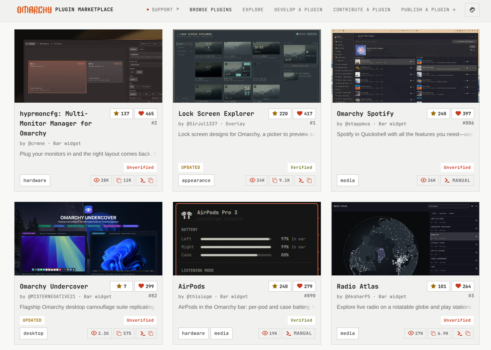

---

<!-- _class: content -->

## OmarchyShell

Omarchyプラグインを支える仕組み。

Omarchyのアプリの仕組み + 上のバーと考えてよい

OmarchyShell = Qt, QML, QuickShell

---

<!-- _class: statement -->

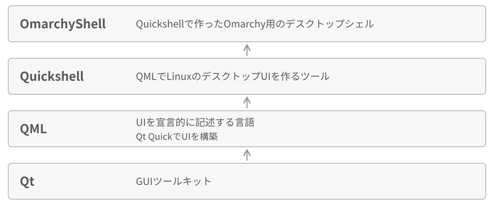

---

<!-- _class: content -->

## OmarchyShell

これらの仕組みを使ってOmarchyプラグインを作るというSkillが最初から入っているので自然に統一感のあるアプリができる。

もちろんThemeに全面対応したアプリができる。

---

<!-- _class: statement -->

## いろんなハードで動くOmarchy

---


<!-- _class: content hardware -->

## Androidスマホでも

### Google Pixel 7 Pro

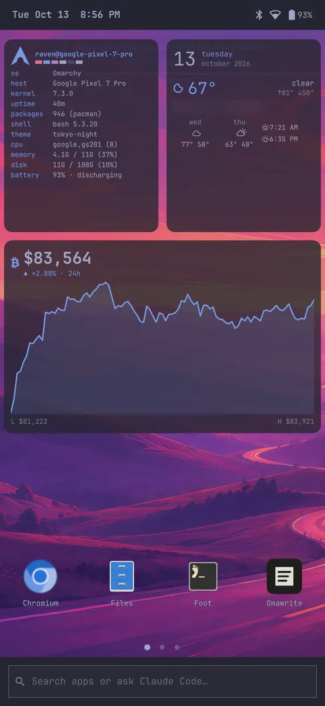

> “Recorded on my Pixel 7 Pro running Omarchy!”

Androidを介さず、Linuxとして実機起動。

[@derekmross](https://x.com/derekmross/status/2110175584513056874)  
Omarchy Mobile／開発中

<!--
出典: https://x.com/derekmross/status/2110175584513056874
画像取得元: https://omarchyarchive.com/images/posts/derekmross-omarchy-mobile-quick-demo.webp
動作は投稿者の報告。端末上での独立した動作検証は行っていない。
-->

---

<!-- _class: content hardware -->

## iPhoneでも

### iPhone 6

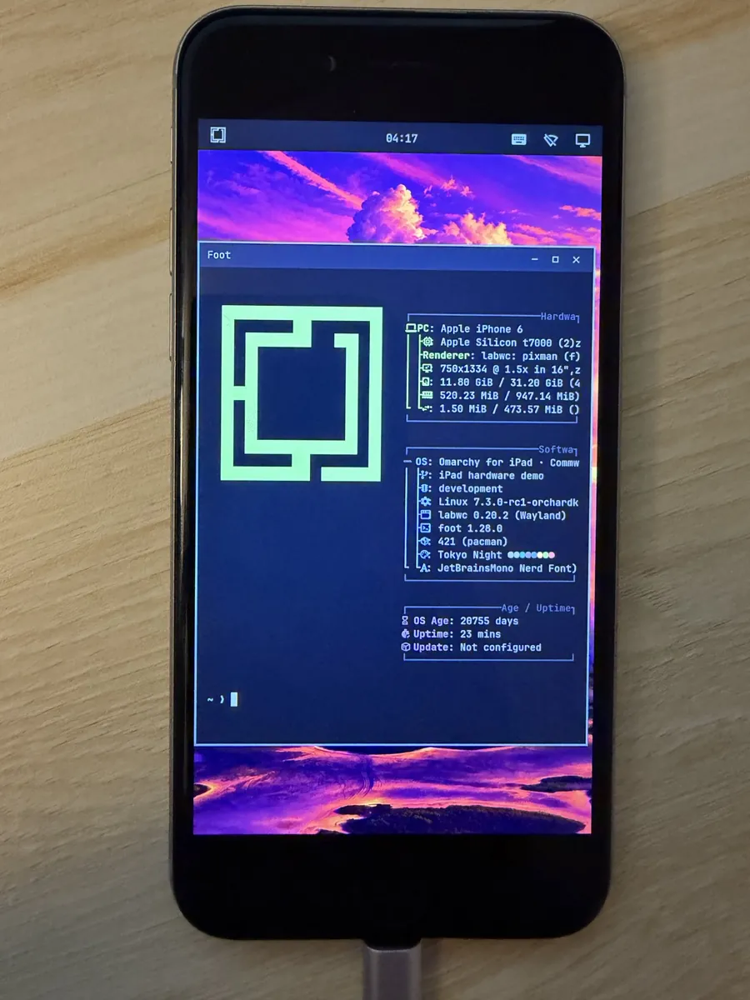

> “iPhone 6 with @omarchy Orchard Linux.”

メモリ1GBのiPhoneにLinuxデスクトップ。

[@shayne_legault](https://x.com/shayne_legault/status/2115660876514787787)  
Orchard Linux／Omarchy派生・実験段階

<!--
出典: https://x.com/shayne_legault/status/2115660876514787787
画像取得元: https://omarchyarchive.com/images/posts/shayne-legault-iphone-6-orchard-linux.webp
動作は投稿者の報告。端末上での独立した動作検証は行っていない。
-->

---

<!-- _class: content hardware -->

## iPadでも

### iPad 6

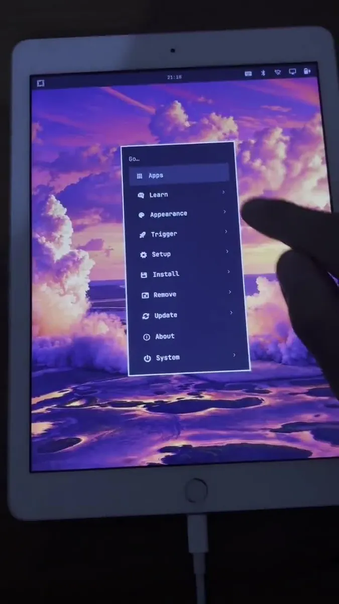

> “Omarchy running natively on iPad 6”

実機起動。タッチ操作・Wi-Fiにも対応。

[@henrikklee](https://x.com/henrikklee/status/2113026261417418965)  
Orchard Linux／Omarchy派生・実験段階

<!--
出典: https://x.com/henrikklee/status/2113026261417418965
画像取得元: https://omarchyarchive.com/images/posts/henrikklee-omarchy-native-ipad-6.webp
動作は投稿者の報告。端末上での独立した動作検証は行っていない。
-->

---

<!-- _class: content hardware-wide -->

## PlayStationでも — PS4 Slim（Baikal B1）

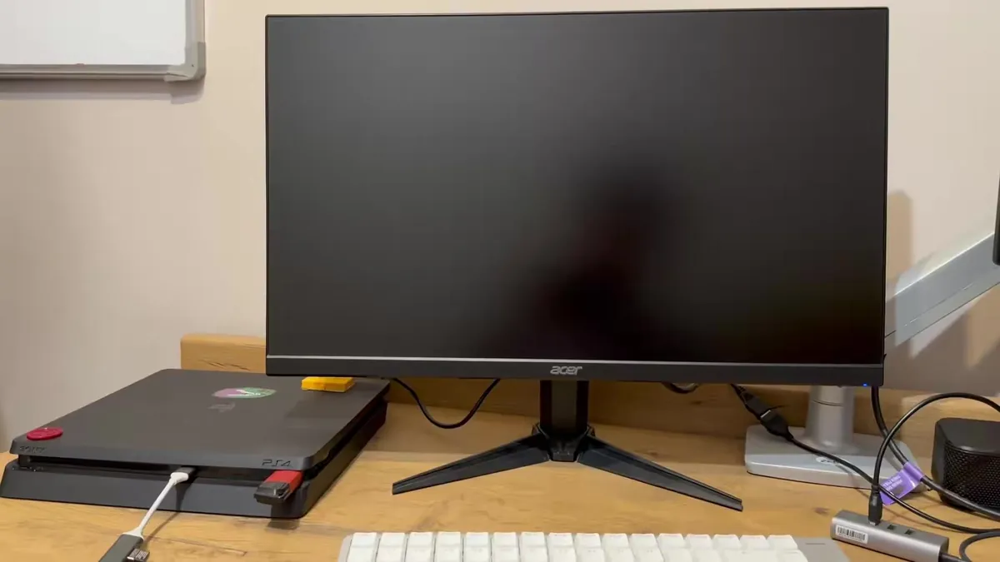 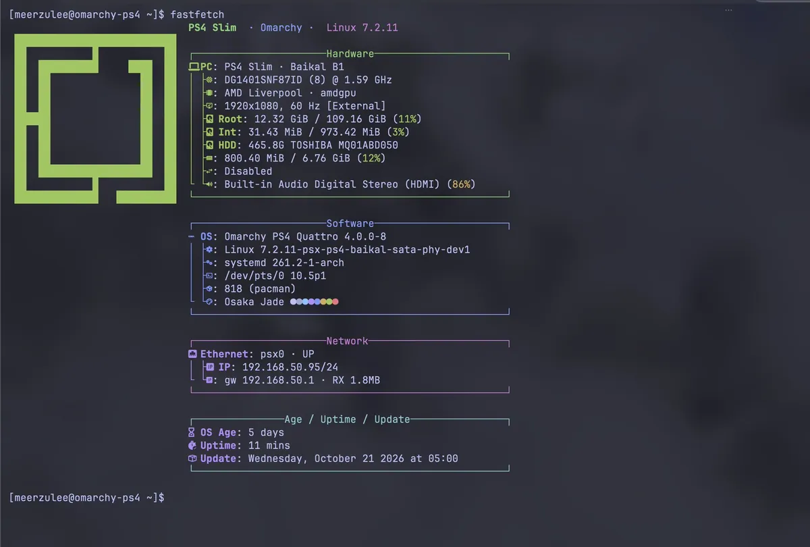

> “PS4 Slim (Baikal B1) running Linux 7.2.11”

実機でOmarchy/Archデスクトップ。Ethernet・HDMI音声も動作報告。

[@meerzulee](https://x.com/meerzulee/status/2113252938525347845)  
コミュニティ移植／開発中

<!--
出典: https://x.com/meerzulee/status/2113252938525347845
画像取得元: https://omarchyarchive.com/images/posts/meerzulee-ps4-slim-baikal-linux-7-2-11.webp
動作は投稿者の報告。端末上での独立した動作検証は行っていない。
実機写真: https://omarchyarchive.com/posts/omarchyupdates-ps4/
-->

---

<!-- _class: content hardware -->

## Snapdragonでも

### ASUS Zenbook A16

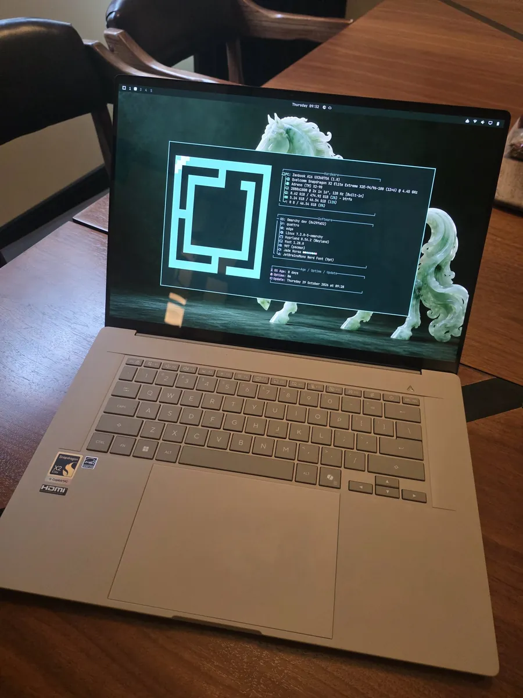

> “Omarchy running on the Asus Zenbook A16 with the @Snapdragon X2 Extreme chip.”

DHH本人がSnapdragon X2 Extremeで起動。

[@dhh](https://x.com/dhh/status/2115819928242491628)  
開発版／投稿時点ではWebカメラ・Bluetooth未対応

<!--
出典: https://x.com/dhh/status/2115819928242491628
画像取得元: https://omarchyarchive.com/images/posts/dhh-asus-zenbook-a16-snapdragon-x2-extreme.webp
動作は投稿者の報告。端末上での独立した動作検証は行っていない。
-->

---

<!-- _class: content hardware-wide -->

## TVでも：OmarchyTV

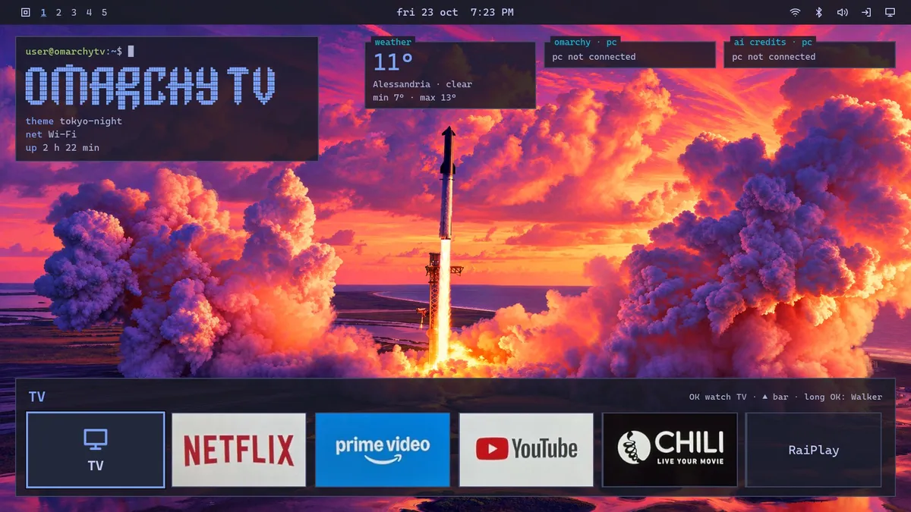

Android TV向けのOmarchy風ホーム画面。

[@MarcoPorro](https://x.com/MarcoPorro/status/2113687696400896055) — “OmarchyTV 2.11.0-beta is out”  
非公式ランチャー／ベータ版

<!--
出典: https://x.com/MarcoPorro/status/2113687696400896055
画像取得元: https://omarchyarchive.com/images/posts/marcoporro-omarchytv-v2-11-0-beta.webp
プロジェクト: https://github.com/piermark/omarchytv
Omarchy本体のネイティブ移植ではなく、Android TV向けのOmarchy風ホームアプリ。
-->

---

<!-- _class: content hardware -->

## MシリーズMacでも

### MacBook Pro（M1・2020）

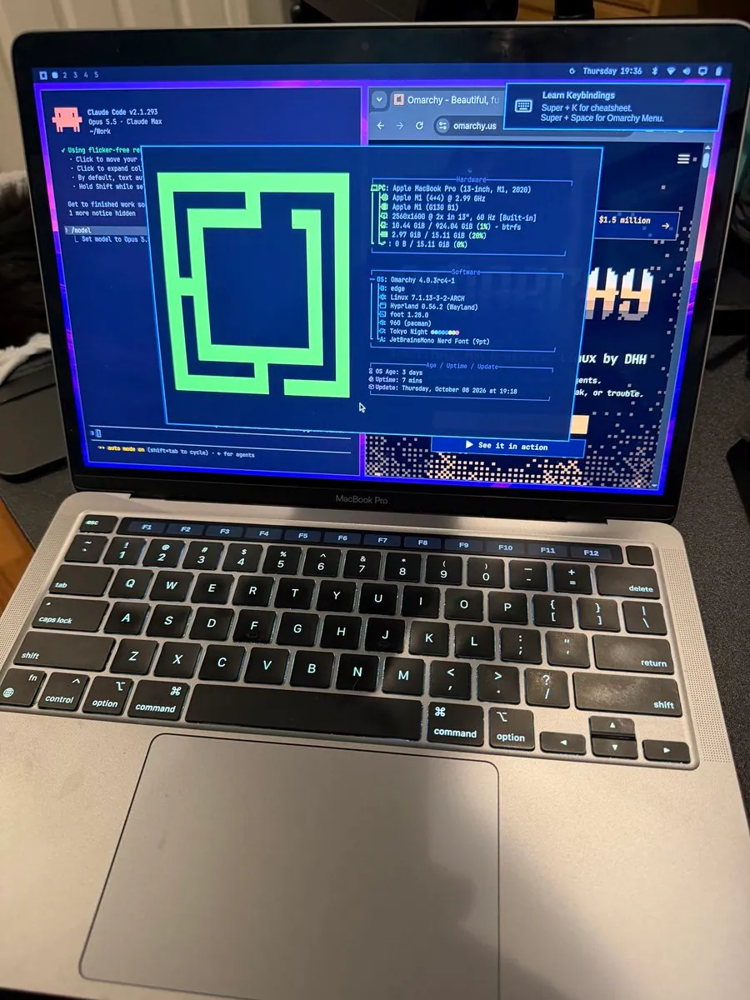

> “Installed Omarchy on this touchbar M1 MacBook Pro with 16GB - painless install and speedy!”

M1 MacBook Proに実機インストール。

[@twid](https://x.com/twid/status/2108386644994998456)  
Omarchy Mac／Apple Silicon

<!--
出典: https://x.com/twid/status/2108386644994998456
画像取得元: https://omarchyarchive.com/images/posts/twid-m1-touchbar-install.webp
動作は投稿者の報告。端末上での独立した動作検証は行っていない。
-->

---

<!-- _class: statement -->

## パトロン

---


<!-- _class: builders -->

## 創立パトロン

  
**Tobi Lütke**  
Shopify共同創業者。  
世界的なネット通販基盤を作る。

  
**Patrick Collison**  
Stripe共同創業者。  
ネット決済のインフラを作る。

  
**Michael Dell**  
Dell創業者。  
世界的なPCメーカーを築いた。

  
**Jack Dorsey**  
TwitterとSquareの共同創業者。  
SNSと決済の両方を変えた。

  
**Matthew Prince**  
Cloudflare共同創業者。  
Webの高速化と安全を支える。

  
**Brendan Iribe**  
Oculus共同創業者。  
VRを広め、今は音声AIのSesame。

---

<!-- _class: builders -->

## 創立パトロン

  
**Jason Fried**  
37signals共同創業者。  
Basecampと「REWORK」の人。

  
**Drew Houston**  
Dropbox共同創業者。  
ファイル共有を当たり前にした。

  
**Peter Steinberger**  
自律型AIエージェント  
OpenClawの作者。

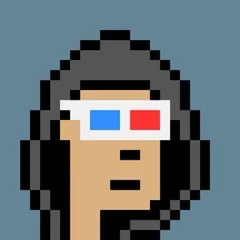  
**Brian Armstrong**  
Coinbase共同創業者。  
暗号資産取引所の大手を築いた。

  
**Yunjie Dai**  
ゲーム配信サービス  
TapTapの共同創業者。

  
**DHH**  
Ruby on RailsとOmarchyの作者。  
37signals共同創業者。

---

<!-- _class: statement -->

## コミュニティ

---

<!-- _class: statement photo-quote -->

100%, everything is written by agents but steered by me.


---


---

<!-- _class: statement -->

AI全振りの楽観主義者がOSを作るとどうなるか？

---


---

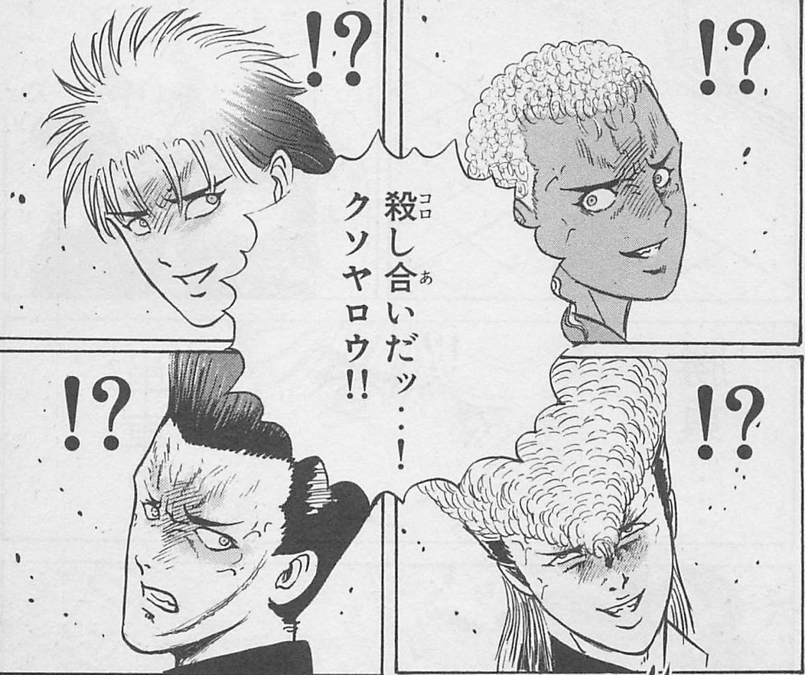

---

<!-- _class: statement -->

スゴイBuilderがあつまってくる

---

<!-- _class: builders -->

## OmarchyのスゴイBuilderたち

  
**outfoxxed**  
バーも通知もロック画面も。  
その土台、Quickshellの作者。

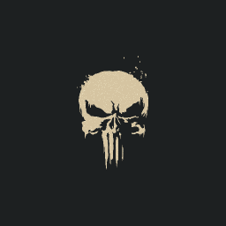  
**HANCORE**  
テーマだけでは飽き足らず、  
プラグイン市場まで作った。

  
**Bjarne Øverli**  
音楽プレイヤーCliampに  
テーマ編集Aether。次々作る。

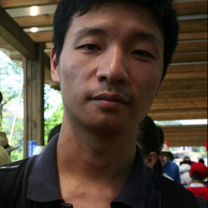  
**huacnlee**  
メールもファイル共有も。  
UI部品まで自分で作る。

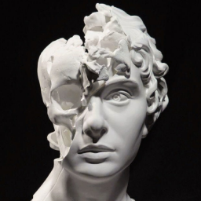  
**0xSero**  
手元のGPUをAI工場に。  
ローカルAIをバーから操作。

  
**ThePrimeagen**  
AIにOSを操作させてテスト。  
QAそのものを自動化中。

---

<!-- _class: builders -->

## OmarchyのスゴイBuilderたち

  
**Henrik Klee**  
iPadでOmarchyを動かし、  
インストーラーまで作った。

  
**Marcelo Alcantara**  
Apple SiliconにもOmarchy。  
Mac移植の中心人物。

  
**Tom Ballard**  
マウスの周りにアプリが並ぶ。  
円形ランチャーOrbを作った。

  
**Fred Nix**  
壁紙までAI監視画面に。  
Infomarchyほか多数開発。

  
**OldJobobo**  
デスクトップの空気を変える。  
Miasmaほかテーマを量産。

  
**Krzysztof Wilczyński**  
Linux PCI共同メンテナー。  
カーネルから速くする。

###### 他多数

---

<!-- _class: statement -->

RubyやRailsもそうだったように、こういう技術の初期にはスゴイ人が集まってきてスゴイことをする。

---

<!-- _class: statement -->

## 最新！Omarchy Quattro 4.5 RS情報

---

<!-- _class: content -->

## Omarchy Quattro 4.5 RSとは

- 次に出る最新のOmarchy
- RC2が出てるので明日にもリリースされるかも
- DHHいわく「追加機能が多過ぎる。3つのリリースにすべきだった」
- komagataのcontributionも少しだけ入ってる


---

<!-- _class: content release-feature release-side -->

## 50言語に対応

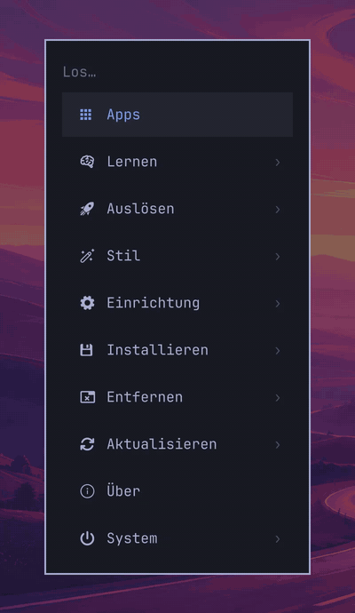

メニューや通知を、その場で自分の言語に。

<!--
Omarchy 4.5.0-rc2 時点の予定機能。
出典: https://github.com/omacom/omarchy/releases/tag/v4.5.0-rc2

-->

---

<!-- _class: content release-feature -->

## 浮かせるウィンドウ ＋ Dock

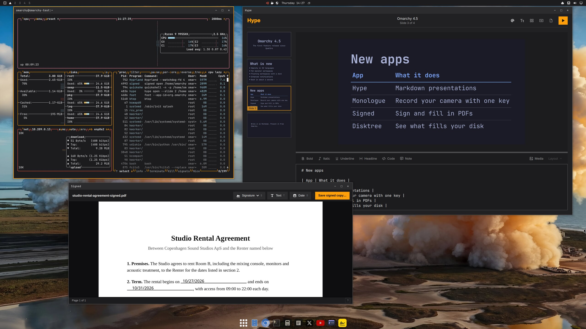

タイル・スクロール・フローティングを Super + L で切り替え。

<!--
Omarchy 4.5.0-rc2 時点の予定機能。
出典: https://github.com/omacom/omarchy/releases/tag/v4.5.0-rc2

-->

---

<!-- _class: content release-feature -->

## モニターごとにワークスペース

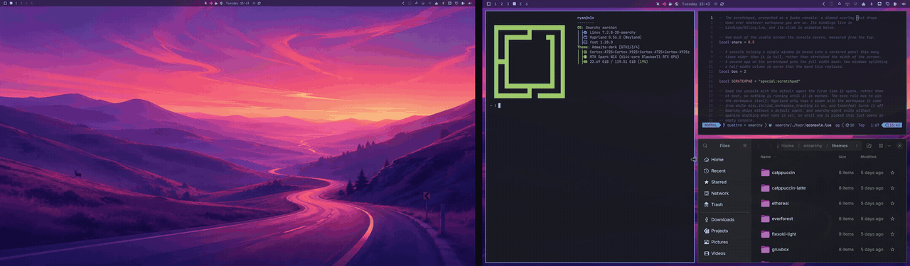

画面ごとに独立した作業場所。複数モニターでも迷わない。

<!--
Omarchy 4.5.0-rc2 時点の予定機能。
出典: https://github.com/omacom/omarchy/releases/tag/v4.5.0-rc2

-->

---

<!-- _class: content release-feature release-side -->

## 通知を刷新

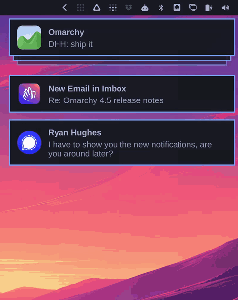

送信元ごとに整理。ボタン・認証コード・リンクも通知から操作。

<!--
Omarchy 4.5.0-rc2 時点の予定機能。
出典: https://github.com/omacom/omarchy/releases/tag/v4.5.0-rc2

-->

---

<!-- _class: content release-feature release-side -->

## 見た目の設定を一か所に

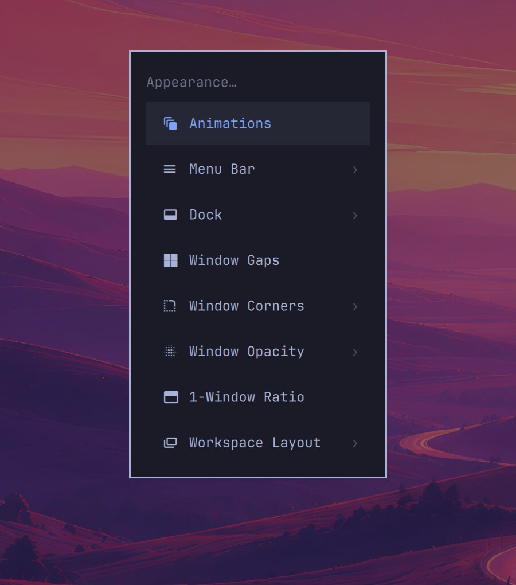

テーマ、Dock、余白、角丸、透明度を Appearance メニューへ。

<!--
Omarchy 4.5.0-rc2 時点の予定機能。
出典: https://github.com/omacom/omarchy/releases/tag/v4.5.0-rc2

-->

---

<!-- _class: content release-feature -->

## 動く壁紙 ＆ テーマのイントロ

<video src="images/quattro-4.5/ethereal-cosmic.mp4" poster="images/quattro-4.5/ethereal-cosmic-poster.jpg" width="1120" height="460" autoplay loop muted playsinline controls preload="auto" style="display:block;max-width:100%;object-fit:contain;margin:0 auto" aria-label="Etherealの宇宙・星雲のイントロ動画"></video>

ログインやテーマ切り替えにも、短いアニメーション。

<!--
Omarchy 4.5.0-rc2 時点の予定機能。
出典: https://github.com/omacom/omarchy/releases/tag/v4.5.0-rc2
公式Etherealテーマのcosmicイントロ動画を埋め込み（自動再生・ミュート・ループ・手動操作可）。
動画: https://github.com/omacom/omarchy/blob/v4.5.0-rc2/themes/ethereal/backgrounds/intros/1-cosmic.mp4ロック画面は動画の静止フレーム。
-->

---

<!-- _class: content release-feature -->

## F1インストーラー

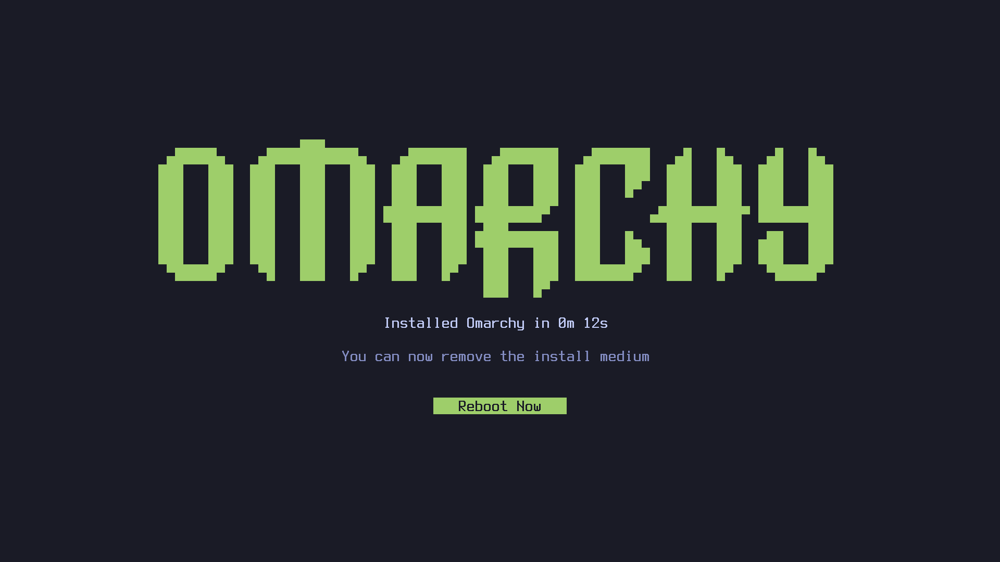

約940パッケージの逐次導入から、構築済みイメージの展開へ。

<!--
Omarchy 4.5.0-rc2 時点の予定機能。
出典: https://github.com/omacom/omarchy/releases/tag/v4.5.0-rc2

-->

---

<!-- _class: content release-feature -->

## 起動時の待ち時間を短縮

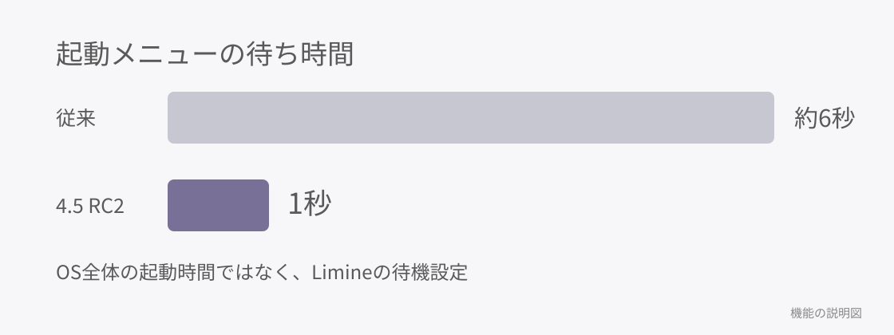

起動メニューの待機を約6秒 → 1秒に。起動も静かに。

<!--
Omarchy 4.5.0-rc2 時点の予定機能。
出典: https://github.com/omacom/omarchy/releases/tag/v4.5.0-rc2

-->

---

<!-- _class: content release-feature -->

## 毎日の操作を、さらに速く

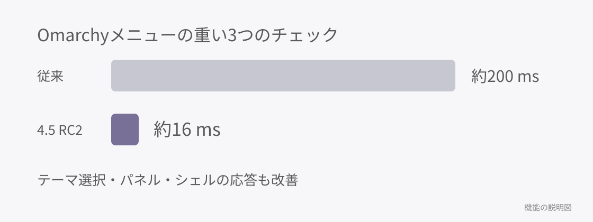

メニューやテーマ切り替えの待ち時間を削減。

<!--
Omarchy 4.5.0-rc2 時点の予定機能。
出典: https://github.com/omacom/omarchy/releases/tag/v4.5.0-rc2
公式RC2記載値。図はメニュー内の3つのチェックの所要時間。PC全体のベンチマークではない。
-->

---

<!-- _class: content release-feature -->

## Hype：Markdownからスライド

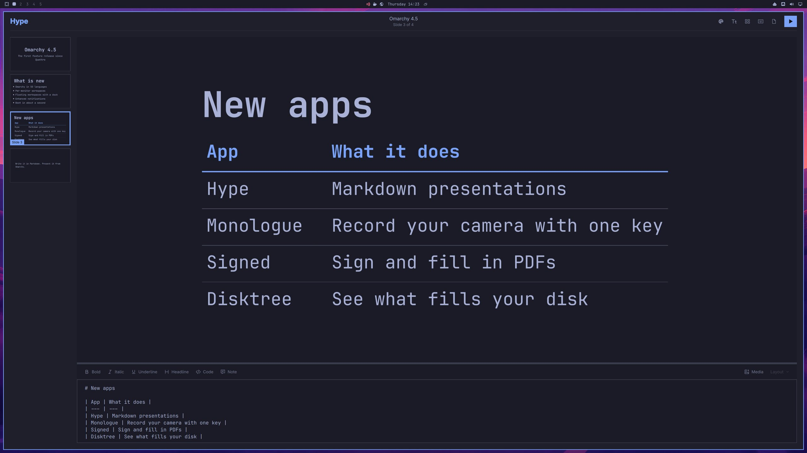

ソースの隣でプレビュー。PDF・PowerPointにも書き出せる。

<!--
Omarchy 4.5.0-rc2 時点の予定機能。
出典: https://github.com/omacom/omarchy/releases/tag/v4.5.0-rc2

-->

---

<!-- _class: content release-feature -->

## Signed：PDFに署名

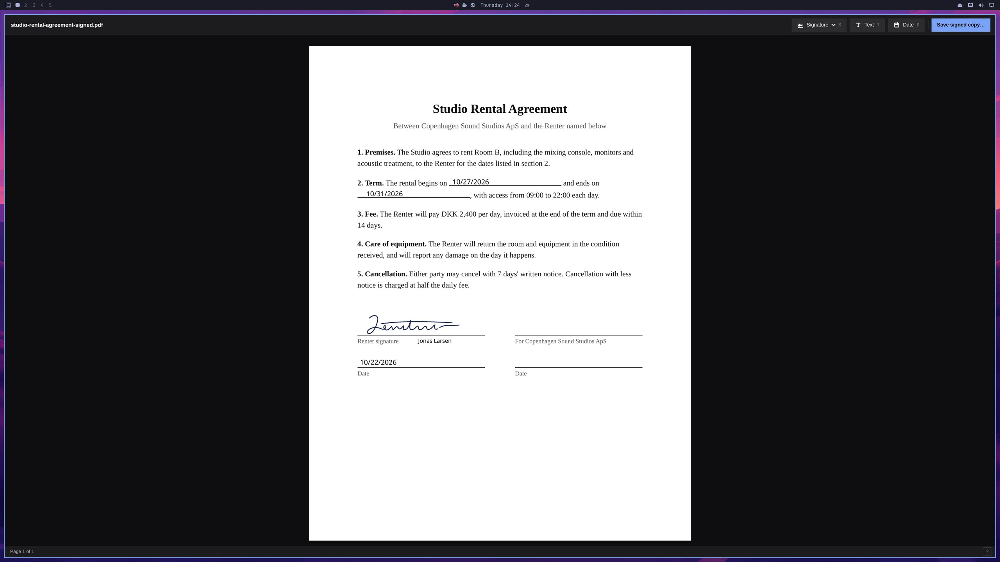

保存した署名、テキスト、日付を置いて、そのまま保存。

<!--
Omarchy 4.5.0-rc2 時点の予定機能。
出典: https://github.com/omacom/omarchy/releases/tag/v4.5.0-rc2

-->

---

<!-- _class: content release-feature -->

## Disktree：ディスクの中身を可視化

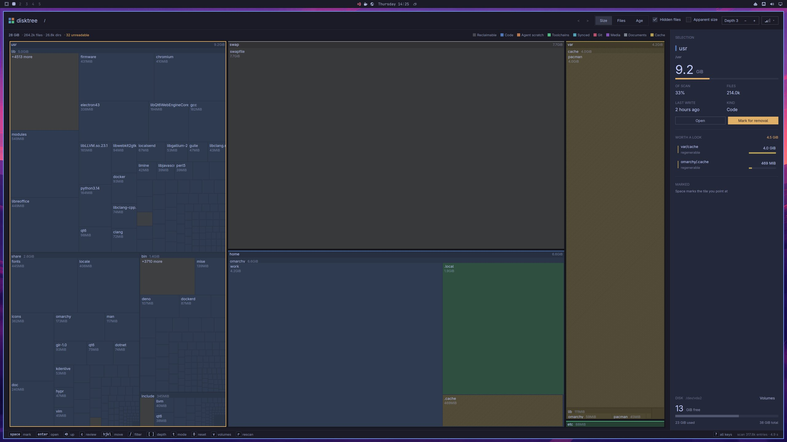

容量を使うファイルや、削除候補のキャッシュがひと目で分かる。

<!--
Omarchy 4.5.0-rc2 時点の予定機能。
出典: https://github.com/omacom/omarchy/releases/tag/v4.5.0-rc2

-->

---

<!-- _class: content release-feature -->

## Monologue：カメラ録画

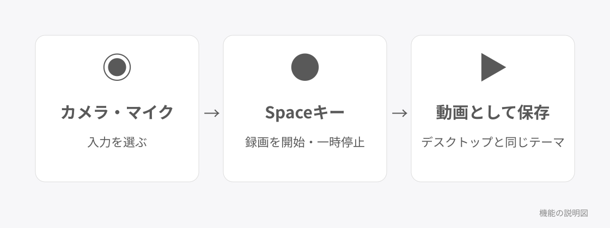

Spaceキーで録画。デスクトップのテーマにもなじむ。

<!--
Omarchy 4.5.0-rc2 時点の予定機能。
出典: https://github.com/omacom/omarchy/releases/tag/v4.5.0-rc2
説明図。アプリ画面ではない。補足: https://github.com/omacom/monologue
-->

---

<!-- _class: content release-feature release-side -->

## Elsewhen：世界時計

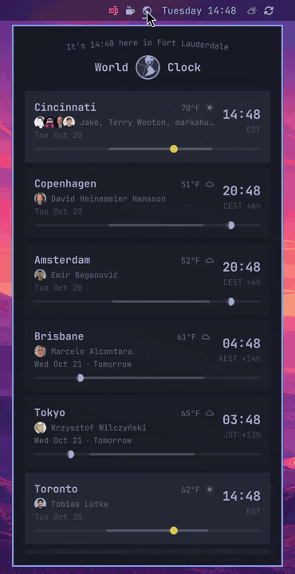

地球儀から都市を選び、離れた場所の時間を確認。

<!--
Omarchy 4.5.0-rc2 時点の予定機能。
出典: https://github.com/omacom/omarchy/releases/tag/v4.5.0-rc2

-->

---

<!-- _class: content release-feature -->

## Quake風のターミナル

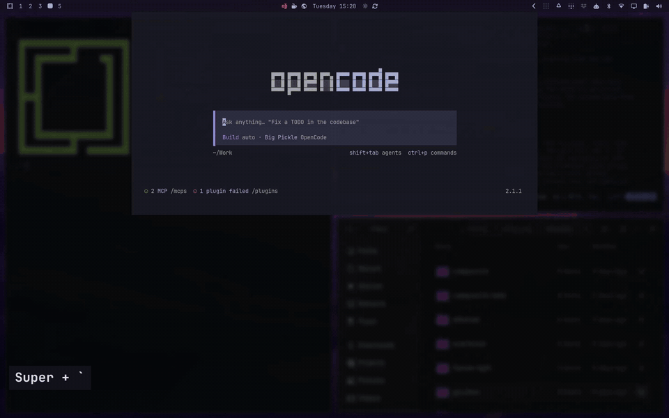

Super + ` で呼び出す、AIエージェントにも便利なコンソール。

<!--
Omarchy 4.5.0-rc2 時点の予定機能。
出典: https://github.com/omacom/omarchy/releases/tag/v4.5.0-rc2

-->

---

<!-- _class: content release-feature -->

## NVIDIAのARMマシンにも対応

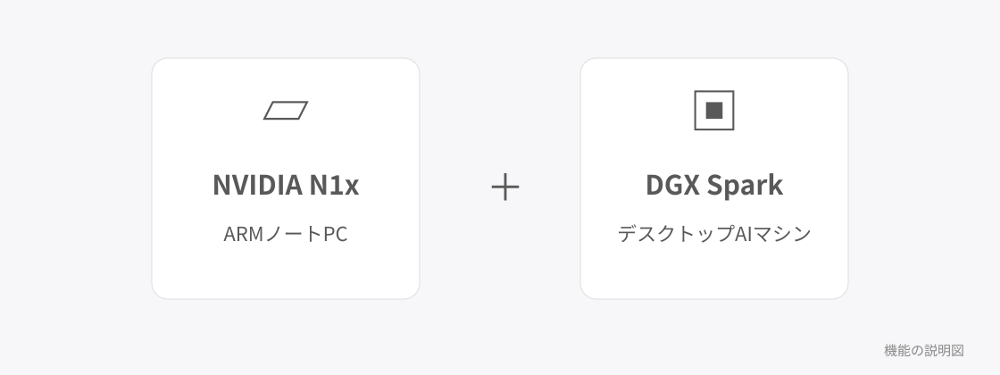

N1x搭載ノートPCと DGX Spark のサポートを追加。

<!--
Omarchy 4.5.0-rc2 時点の予定機能。
出典: https://github.com/omacom/omarchy/releases/tag/v4.5.0-rc2

-->

---

<!-- _class: content release-feature -->

## Snapdragon搭載ノートPCに対応


ARMノートPCも、Omarchyの選択肢に。

<!--
Omarchy 4.5.0-rc2 時点の予定機能。
出典: https://github.com/omacom/omarchy/releases/tag/v4.5.0-rc2
写真は既存ハードウェア章と同じDHHのZenbook A16動作報告。出典はimages/hardware/sources.json。
-->

---

<!-- _class: content release-feature -->

## Apple Silicon対応への統合


Omarchy Macを本体へ統合。Apple Silicon対応の土台に。

<!--
Omarchy 4.5.0-rc2 時点の予定機能。
出典: https://github.com/omacom/omarchy/releases/tag/v4.5.0-rc2
画像は既存のM1動作報告。全Mシリーズの正式対応・全機能の完成を意味しない。出典はimages/hardware/sources.json。
-->

---

<!-- _class: content release-feature -->

## 新しい標準テーマ：Starship

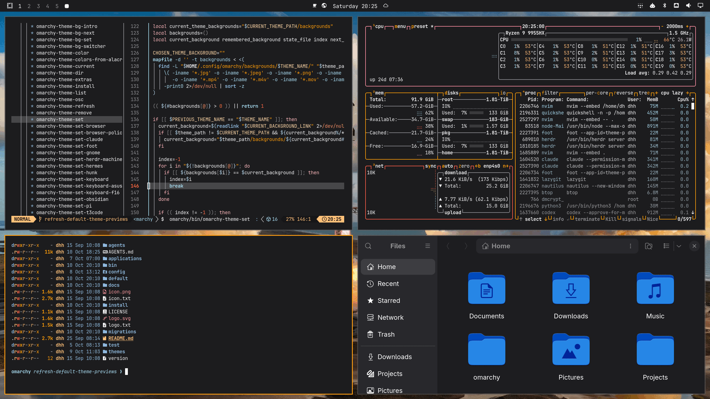

ロケットの風景と、落ち着いた配色。

<!--
Omarchy 4.5.0-rc2 時点の予定機能。
出典: https://github.com/omacom/omarchy/releases/tag/v4.5.0-rc2

-->

---

<!-- _class: content release-feature -->

## 新しい標準テーマ：Jade Horse

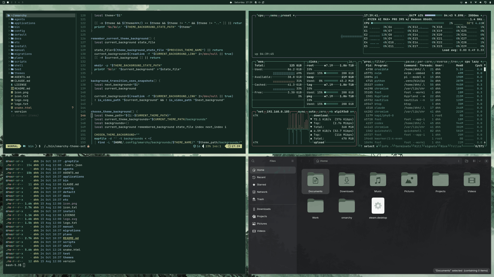

翡翠色と馬のモチーフ。デスクトップ全体を統一。

<!--
Omarchy 4.5.0-rc2 時点の予定機能。
出典: https://github.com/omacom/omarchy/releases/tag/v4.5.0-rc2

-->

---

<!-- _class: content release-feature -->

## 日本語入力もインストーラーから


日本語・中国語・韓国語の入力環境を導入できる。

<!--
Omarchy 4.5.0-rc2 時点の予定機能。
出典: https://github.com/omacom/omarchy/releases/tag/v4.5.0-rc2
https://github.com/omacom/omarchy/pull/14433
-->

---

<!-- _class: content release-feature -->

## 音声入力を標準の選択肢に


Superwhisper と Voxtype の導入に対応。

<!--
Omarchy 4.5.0-rc2 時点の予定機能。
出典: https://github.com/omacom/omarchy/releases/tag/v4.5.0-rc2
https://github.com/omacom/omarchy/pull/14552
-->

---

<!-- _class: content release-feature -->

## Claude・Codexの契約を切り替え


複数アカウントを、作業に合わせて使い分ける。

<!--
Omarchy 4.5.0-rc2 時点の予定機能。
出典: https://github.com/omacom/omarchy/releases/tag/v4.5.0-rc2
https://github.com/omacom/omarchy/pull/13770
-->

---

<!-- _class: content release-feature -->

## AIエージェントの対応を拡大


11のエージェントを追加。パネルで23のエージェント・プロバイダーを追跡。

<!--
Omarchy 4.5.0-rc2 時点の予定機能。
出典: https://github.com/omacom/omarchy/releases/tag/v4.5.0-rc2
https://github.com/omacom/omarchy/pull/14040
画像は既存のエージェントパネル紹介画像。RC2の全23項目が写っていることを示すものではない。
-->

---

<!-- _class: content release-feature -->

## Omasnap：スクリーンショットを刷新


Tensakuに代わる撮影ツール。通知から開く・編集する。

<!--
Omarchy 4.5.0-rc2 時点の予定機能。
出典: https://github.com/omacom/omarchy/releases/tag/v4.5.0-rc2
https://github.com/omacom/omarchy/pull/9446
https://github.com/omacom/omarchy/pull/16505
-->

---

<!-- _class: content release-feature -->

## gliff：SSHでリモートデスクトップ


別のマシンのデスクトップを、手元のウィンドウに。

<!--
Omarchy 4.5.0-rc2 時点の予定機能。
出典: https://github.com/omacom/omarchy/releases/tag/v4.5.0-rc2
公式スクリーンショット: https://github.com/omacom/gliff
https://github.com/omacom/omarchy/pull/14712
-->

---


<!-- _class: statement -->

さて

---

<!-- _class: statement -->

もうOmarchy使いたくなりました・・・よね？

---

<!-- _class: content -->

## コンピューターを選ぶ

いろんなので動くので自分がもってるのでいいとおもう。

メモリ2GBもあれば大抵動く。macでも大抵動く。

中古で安いPCを買ってもいい

---


---

<!-- _class: content -->

## DHHおすすめは

- Dell XPS 13: タッチできて19万
- Dell XPS 14: DHH愛用。たかい。
- Framework Laptop 13: 日本では販売してないので技適無し

---

<!-- _class: content -->

## Omarchyの始め方

まずはTry Omarchyおすすめ。

自分のWindowsやMac上でOmarchyを試せる。

普通に普段使いできるぐらい軽い。

気に入ったらそのままインストールできる。

---


---

<!-- _class: content -->

## Omarchy Bootcamp

インストールから基本操作のレクチャーまでみっちりやるイベントを企画中

---

## おまけ：つくったOmarchyアプリ・サイト

---

<!-- _class: content app-showcase app-showcase-side -->

## O.M.A.（オーマ）


話しかけて、PCを操作するAIアシスタント。

会話の記憶と、Omarchyのテーマに合う顔。

<!--
komagata制作物。
出典: https://github.com/komagata/oma

-->

---

<!-- _class: content app-showcase -->

## OmaText


余計なものを省いた、Omarchyになじむテキストエディター。

<!--
komagata制作物。
出典: https://github.com/komagata/OmaText

-->

---

<!-- _class: content app-showcase -->

## Screen Lens


アプリを改造せず、画面のスナップショットを翻訳。

<!--
komagata制作物。
出典: https://github.com/komagata/screen-lens
公開デモGIFの10秒地点から翻訳結果の静止画を抽出。処理待ち時間は元デモで省略されている。リアルタイム・連続翻訳ではない。
-->

---

<!-- _class: content app-showcase -->

## LINE for Omarchy


Omarchyの見た目になじむ、非公式のLINEクライアント。

<!--
komagata制作物。
出典: https://github.com/komagata/line

-->

---

<!-- _class: content app-showcase app-showcase-side -->

## Omarchy Input Methods


日本語・中国語・韓国語も、同じパネルから切り替え。

Mozc・Hazkey・Rime・Hangulなど、Fcitx 5の入力方式に対応。

<!--
komagata制作物。
出典: https://github.com/komagata/omarchy-input-method

-->

---

<!-- _class: content app-showcase -->

## Omarchy Upstream


開発の動きと議論を毎日お届け。10言語・RSS対応。

<!--
komagata制作物。
出典: https://ja.omarchyupstream.com/
2026-10-30に公開中の日本語ホームページを撮影。作者の公開告知: https://docs.komagata.org/ および https://omarchyarchive.com/posts/komagata-omarchy-upstream-launch/
-->
