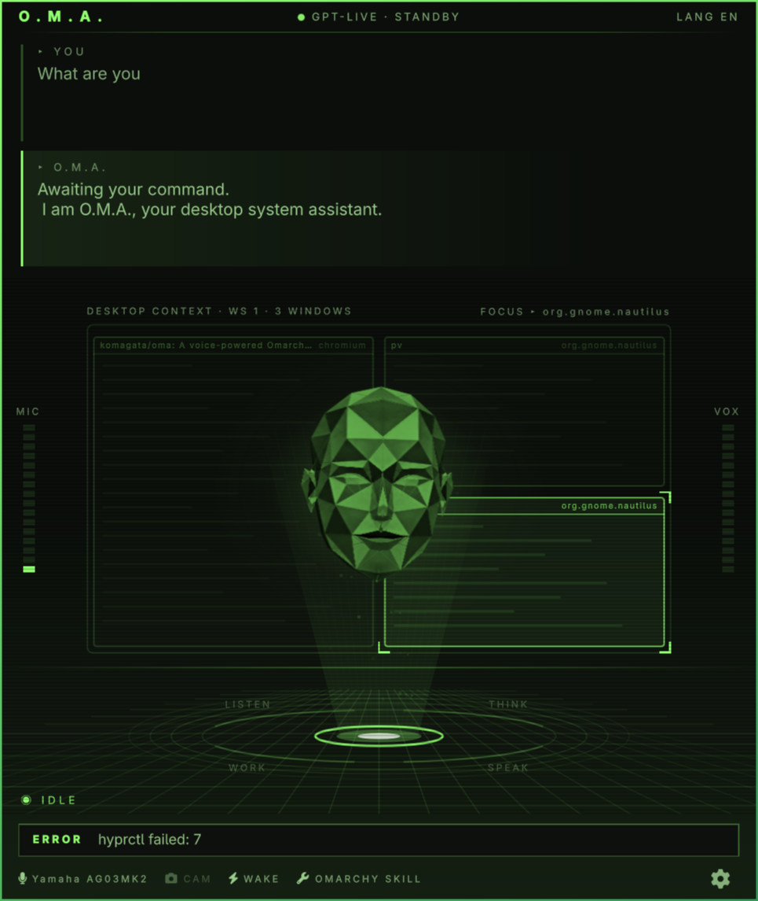
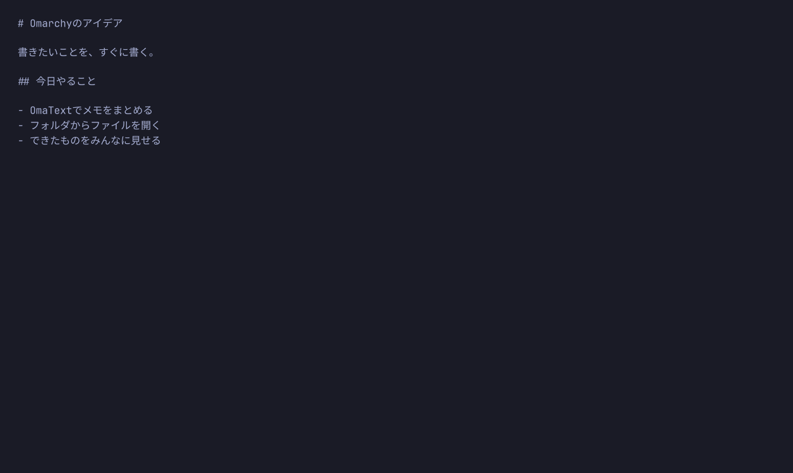
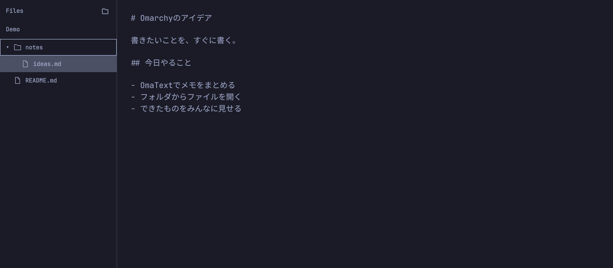
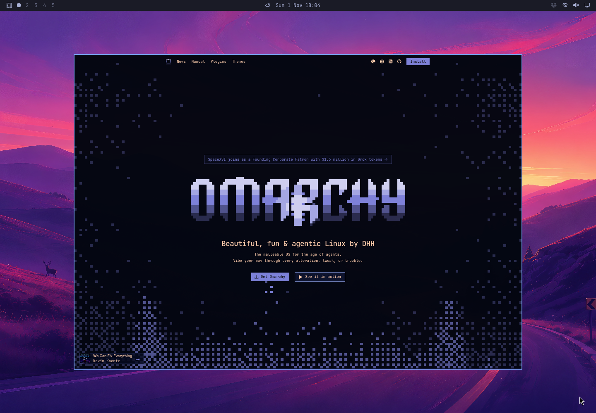
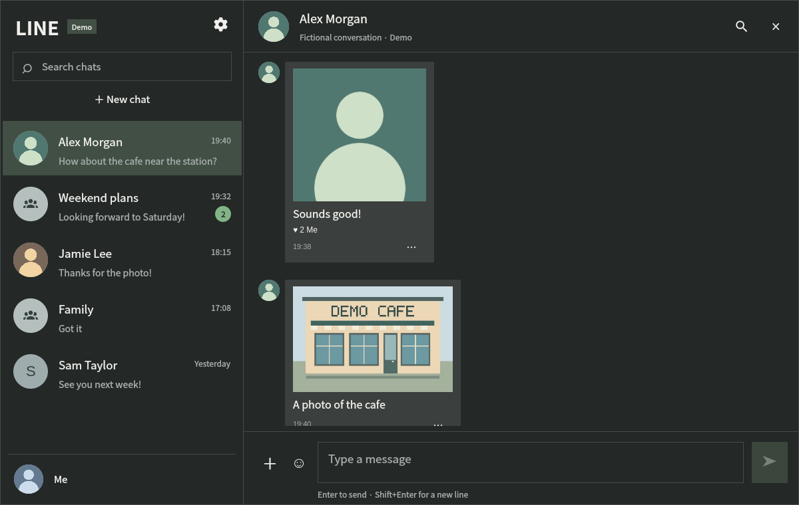
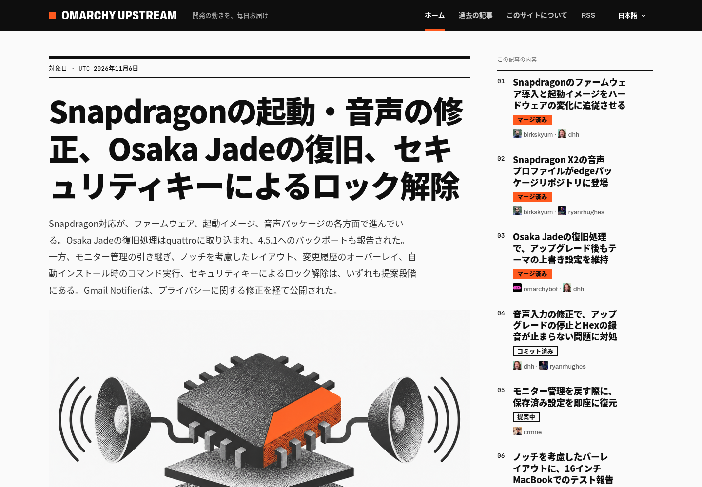
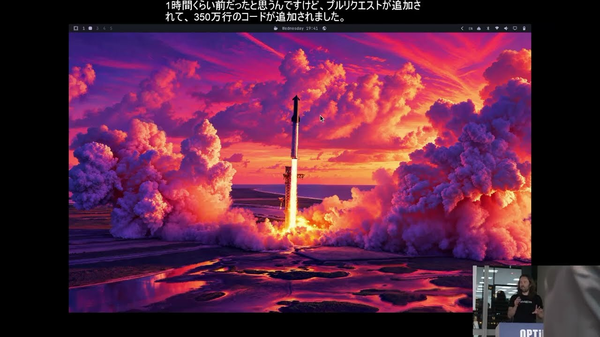
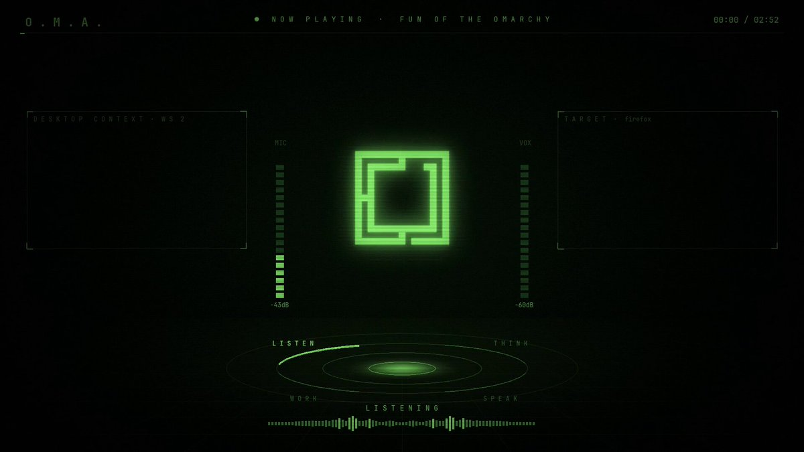
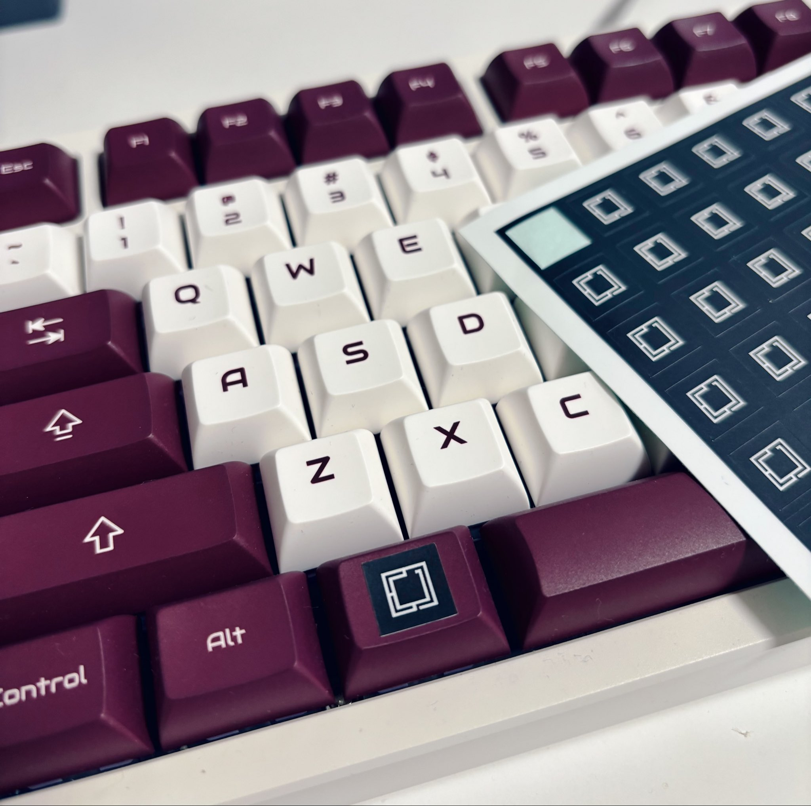

<!-- _class: cover -->

BUILT FOR OMARCHY / BY KOMAGATA

# おれの Omarchy生成物

**OMA / OmaText / Omawser / LINE / Omarchy Upstream**

Masaki Komagata · @komagata

<!-- 今日は自分が作ったOmarchy向けのアプリとWebサイトを紹介します。最後にMeetup、動画、持参したシールの話もあります。 -->

---

<!-- _footer: '' -->
<!-- _paginate: false -->

Omarchy向けに作ったものを紹介します。

---

01 / TALK

<h1>OMA</h1>
<h2>声で話せる、PCの相棒。</h2>
<ul><li>音声会話と字幕</li><li>PC操作をタスクエージェントに依頼</li><li>会話をまたぐローカルの記憶</li></ul>

テーマ色のローポリな顔が目印。[1]

音声利用にはOpenAI APIキーと別途課金が必要。

O.M.A. = Omarchy Machine Assistant / README掲載の実画面

<!-- 「OmaTextでメモを作って」「Chromiumを使うと覚えて」など、具体的な頼み方を紹介。音声側とタスクエージェント側の認証・課金は別です。操作の確認は全操作を自動遮断する仕組みではないため、安全性を過大に説明しないでください。 -->

---

02 / WRITE

<h1>OmaText</h1>
<h2>テキストを、すぐ書く。</h2>
<ul><li>普通のウィンドウ、最小限のUI</li><li>Omarchyのテーマに追従</li><li>日本語IME・ファイルツリーに対応</li></ul>

タブもMarkdownプレビューも、なし。[2]

QML + Python標準ライブラリ。利用時のビルド不要。

ローカル最新版の実画面 / 設定はCtrl+, / 撮影用サンプル

<!-- メモを書き、Ctrl+Sで保存するデモに向く。ファイルツリーはCtrl+B。自動保存や外部変更監視はないので、終了・再読み込み前に保存してください。 -->

---

OMATEXT / FILE TREE

# ファイルツリーから、開く。

Ctrl+Bで表示・非表示を切り替え。ローカル最新版を隔離環境で撮影 / ファイル・文章は撮影用サンプル。

<!-- 実際のQuickshellプラグインを、手元のomatext-keyboard-settings作業ツリーから読み込んで撮影。アプリ本体やユーザーのデスクトップ設定は変更していません。 -->

---

03 / BROWSE

<h1>Omawser</h1>
<h2>Webを、キーボードから。</h2>
<ul><li>1タブなら、ページが主役</li><li>Ctrl+Lでアドレス欄を表示</li><li>タブ切り替えもキーボードで</li></ul>

Omarchyのテーマに追従するブラウザ。[3][7]

Tauri / WebKitGTK。独立したデスクトップアプリ。

README掲載のTokyo Nightテーマでの実画面

<!-- Ctrl+L、Ctrl+T、Ctrl+Tabで操作を見せる。汎用ブラウザの全機能を備えているとは説明しない。カメラ・マイク等の権限要求は拒否する実装で、一部OAuthフローにも制限があります。 -->

---

04 / CHAT

<h1>LINE</h1>
非公式 / 開発中
<h2>Omarchyでも、チャット。</h2>
<ul><li>チャット・返信・添付・スタンプ</li><li>日本語 / EnglishのUI</li><li>QML + Goのプラグイン</li></ul>

LINE公式の製品ではありません。[4]

READMEでは実送信・相手への到達は未検証。

架空の人物・会話を使ったデモ画面

<!-- 画面と実装済みの機能を紹介。保存済みアカウントでチャット等の確認記録はあるが、QRでの再ログイン、実メッセージ送信、相手への配達はREADME上では未検証。安定した公式クライアントの代替と断定しない。 -->

---

05 / FOLLOW DEVELOPMENT

<h1 style="font-size:46px">Omarchy Upstream</h1>
<h2>開発の動きを、読み物に。</h2>
<ul><li>PR・コミット・議論をまとめる</li><li>日本語を含む10言語</li><li>出典と変更の状態を示す</li></ul>

独立運営・非公式のWebサイト。[5][6]

<a href="https://ja.omarchyupstream.com/">ja.omarchyupstream.com</a>

公開サイトのスクリーンショット / アプリではなくWebサイト

<!-- 正式表記はOmarchy Upstream。実装済みと提案中を区別して読むためのサイト。AI支援による編集・翻訳を行いますが、品質を無条件に保証するとは説明しません。 -->

---

COMMUNITY / TOKYO

<h1 style="font-size:45px">Omarchy Tokyo Meetupも開催。</h1>

DHHも来た！

登壇動画をYouTubeで公開しています。[11][12]

Omarchy Quattro RS 4.5 Live Demo - DHH

Omarchy Tokyoチャンネル / QRコード・画像から動画へ

<!-- ユーザー提供の開催・来場の説明に基づくスライド。投稿ではMeetupでのDHH登壇動画の公開を確認。開催日・人数等は未確認なので加えていません。 -->

---

WATCH ON YOUTUBE

<h1 style="font-size:45px">AI時代のOS Omarchy</h1>

Omarchyを知らない人向けに、 <strong>約2時間</strong>話しました。[9]

YouTubeで見られます！

フィヨルドブートキャンプのチャンネル [10]

QRコード・画像をクリックして視聴できます

<!-- 正確な再生時間の計測ではなく、本人の投稿「2時間ぐらい」に沿った表現です。動画内容の要約は行っていません。 -->

---

OMARCHY SONG

<h1 style="font-size:34px;white-space:nowrap">Omarchyの歌を作りました</h1>

ここで、ちょっと聴いてください。[13]

<a href="https://x.com/komagata/status/2110654529209511966" target="_blank" rel="noopener noreferrer" style="display:inline-block;background:#a6da95;color:#171923;padding:14px 20px;font-weight:bold">▶ 歌を開いて再生する</a>

<a href="https://x.com/komagata/status/2110654529209511966" target="_blank" rel="noopener noreferrer">https://x.com/komagata/status/2110654529209511966</a>

ボタン・画像・URLからXの投稿を開けます

<!-- 発表中にボタンをクリックして投稿を別タブで開き、動画の再生ボタンを押す。自動再生は設定していません。 -->

---

ONE MORE THING

<h1 style="font-size:46px">キーのシールを 作りました。</h1>

Omarchyキー用のシール。[8]

今日持ってきているので、 <strong>貼らせてください！</strong>

貼っていい方、ぜひ声をかけてください。

本人のX投稿に掲載した写真

<!-- 持参していることと「貼らせてください」は本人の指定。希望する方だけに貼らせてもらう、という温度感で締めます。 -->

---
<!-- _class: cover -->
<!-- _footer: '' -->
<!-- _paginate: false -->

# Thank you!

---
<!-- _class: sources -->

# Sources

[1] https://github.com/komagata/oma
[2] https://github.com/komagata/OmaText
[3] https://github.com/komagata/omawser
[4] https://github.com/komagata/line
[5] https://ja.omarchyupstream.com
[6] https://github.com/komagata/omarchy-upstream
[7] https://github.com/komagata/omawser/blob/main/docs/browser.md
[8] https://x.com/komagata/status/2118891648675709352
[9] https://x.com/komagata/status/2118509671204134973
[10] https://www.youtube.com/watch?v=roFx9CB_yn0
[11] https://x.com/komagata/status/2118160669300400325
[12] https://www.youtube.com/watch?v=bMrbS98gGIk
[13] https://x.com/komagata/status/2110654529209511966
